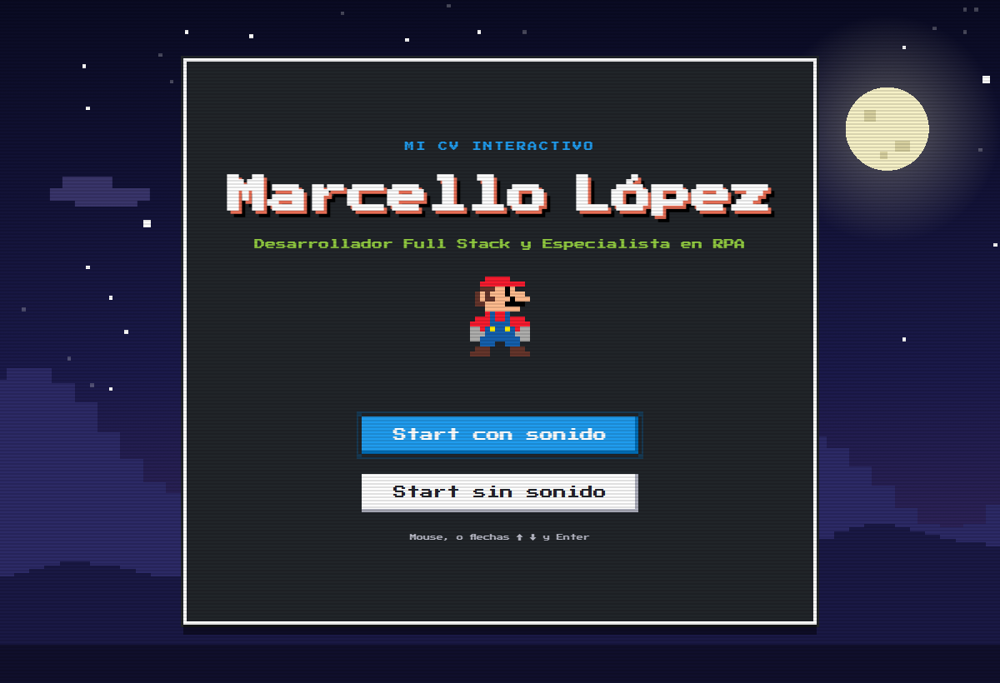
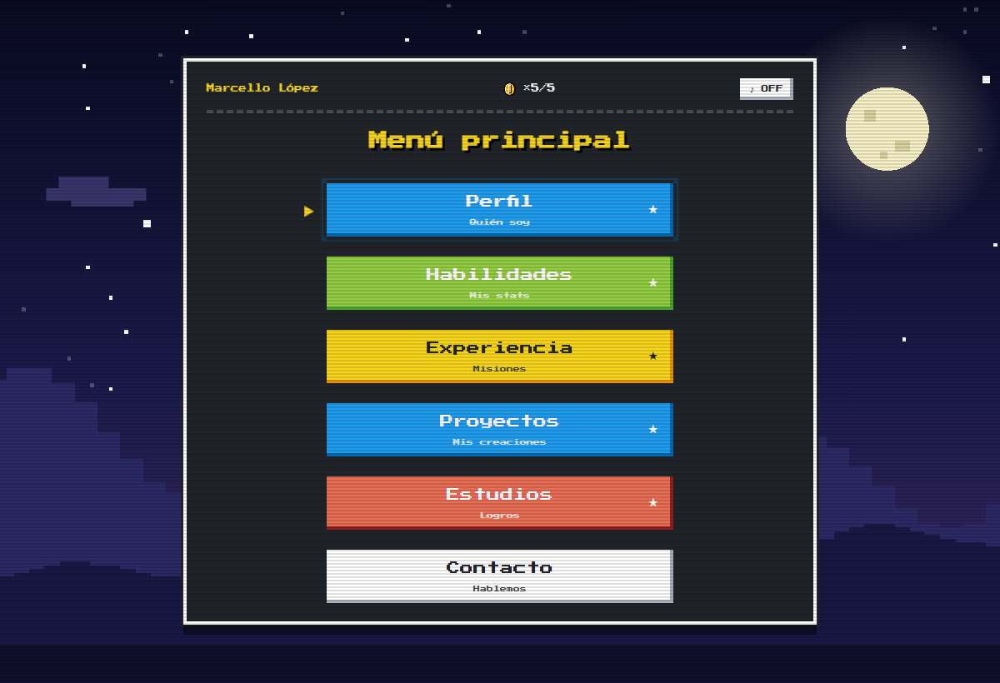
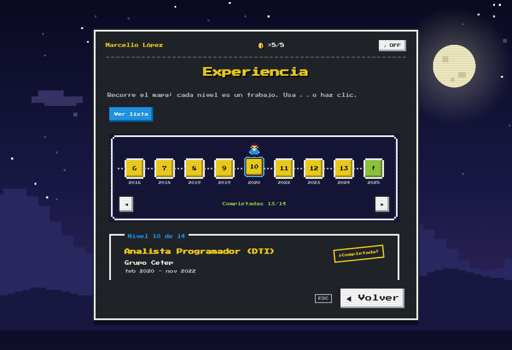
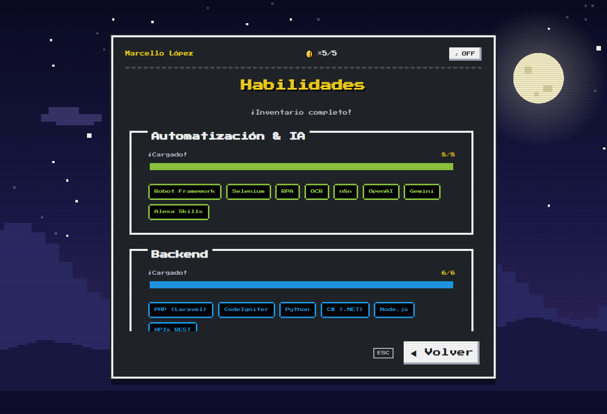
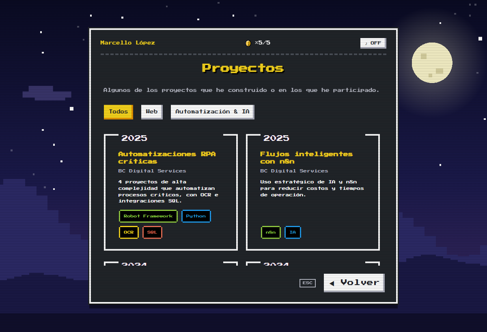
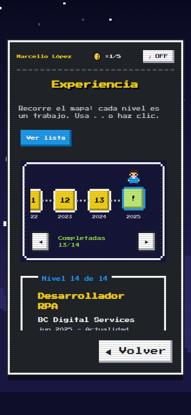

# 🎮 Mi CV Interactivo

**Currículum de Marcello López Cáceres con estética de videojuego retro de 8 bits.**
Desarrollador Full Stack y Especialista en RPA · Santiago, Chile.

[](https://mi-cv-interactivo.vercel.app)




---

## ¿Qué es?

En vez de un PDF, un CV que se **juega**: eliges "Start", navegas por un menú como en una consola
y cada sección es una pantalla distinta, con sonidos, animaciones y una moneda por cada sección visitada.
Al recolectarlas todas, el juego te invita a pasar por Contacto.

| Pantalla | Qué muestra | Mecánica de juego |
| --- | --- | --- |
| **Perfil** | Quién soy y cifras clave | Diálogo tipo RPG que se escribe letra a letra, con sonido de tecleo |
| **Habilidades** | Herramientas por categoría | Inventario que se carga con barras de progreso y sonido |
| **Experiencia** | 14 trabajos desde 2015 | Mapa de niveles: un personaje camina entre misiones y cada una muestra su XP (duración) |
| **Proyectos** | 17 proyectos | Tarjetas filtrables por Web o Automatización & IA |
| **Estudios** | Formación, cursos e idiomas | Sala de trofeos |
| **Contacto** | Correo, LinkedIn y GitHub | Pantalla final, con copiar correo en un clic |

## Capturas

| Menú principal | Experiencia (mapa de niveles) |
| --- | --- |
|  |  |
| **Habilidades (inventario)** | **Proyectos** |
|  |  |

<p align="center"></p>

## Características

- **Sonido instantáneo.** Los efectos se descargan y decodifican una sola vez al cargar (Web Audio con Howler.js),
  así suenan sin retraso incluso la primera vez. El tecleo del diálogo se sintetiza en el navegador, sin archivos.
  Se puede jugar con o sin sonido y cambiarlo en cualquier momento desde el HUD.
- **Animación con sabor retro.** Transiciones con `steps()`, scroll a saltos (pocos fotogramas, como en una consola),
  fondo nocturno en pixel art dibujado en SVG y efecto de pantalla CRT.
- **Rendimiento.** Las capas animadas del fondo solo usan `opacity` y `transform`, y las barras avanzan en saltos
  fijos en vez de repintar cada fotograma, así que va fluido incluso en móviles modestos.
- **Accesible.** Todo se usa con teclado (flechas, Enter, y Esc para volver), con foco visible, textos completos para
  lectores de pantalla y respeto por la preferencia del sistema "reducir movimiento".
- **Responsive.** Pensado también para pantallas de teléfono.
- **Contenido en un solo archivo.** Todo el texto del CV vive en [`src/data/cv.js`](src/data/cv.js).

## Cómo correrlo

Requiere **Node.js 26**.

```bash
git clone https://github.com/marcellolopez/mi_cv_interactivo.git
cd mi_cv_interactivo
npm install
npm run dev       # servidor de desarrollo en http://localhost:5173
```

| Comando | Qué hace |
| --- | --- |
| `npm run dev` | Servidor de desarrollo con recarga en caliente |
| `npm run build` | Compila la versión de producción en `dist/` |
| `npm run preview` | Sirve localmente la versión compilada |
| `npm run lint` | Revisa el código con ESLint |

## Estructura del proyecto

```
mi_cv_interactivo/
├── docs/capturas/          Imágenes de este README
├── public/                 Archivos estáticos (favicon)
├── src/
│   ├── data/cv.js          Todo el contenido del CV (se edita aquí)
│   ├── components/
│   │   ├── Screen/         Marco común: HUD, título, scroll y botón Volver
│   │   ├── Sounds/         Contexto de audio (efectos, música y tecleo)
│   │   ├── Progress/       Monedas por sección visitada y notificaciones
│   │   ├── Background/     Paisaje nocturno en pixel art (SVG)
│   │   ├── Inicio/         Pantalla de título
│   │   ├── MainMenu/       Menú principal
│   │   ├── Perfil/         Diálogo y estadísticas
│   │   ├── Competencias/   Inventario de habilidades
│   │   ├── Experiencia/    Mapa de niveles, personaje y cálculo de duración
│   │   ├── Proyectos/      Tarjetas con filtro
│   │   ├── Estudios/       Formación, cursos e idiomas
│   │   └── Contacto/       Pantalla final
│   ├── hooks/animation.js  Máquina de escribir, progreso, scroll a saltos y navegación con flechas
│   ├── styles/             Estilos, un archivo por pantalla
│   ├── assets/fx/          Efectos de sonido y música
│   ├── App.jsx             Rutas y transiciones
│   └── main.jsx            Punto de entrada
├── index.html
└── vercel.json             Redirige todas las rutas a la aplicación
```

## Actualizar el contenido

No hace falta tocar componentes: basta con editar [`src/data/cv.js`](src/data/cv.js).

- `perfil`: nombre, cargo, años de experiencia y biografía.
- `competencias` y `fortalezas`: categorías del inventario.
- `experiencias`: trabajos, del más reciente al más antiguo. La duración del mapa se calcula sola a partir de la
  fecha (`"jun 2025 - Actualidad"`).
- `proyectos`: con `tipo: 'web'` o `tipo: 'ia'`, y `url` opcional para mostrar el botón "Ver código".
- `formacion`, `cursos`, `idiomas` y `contacto`.

## Despliegue

El sitio se publica automáticamente en **Vercel** con cada push a `master`. La versión de Node se fija en
`package.json` (`"engines": { "node": "26.x" }`) y `vercel.json` hace que cualquier ruta cargue la aplicación.

## Licencia

El código se publica bajo la [licencia MIT](LICENSE): puedes usarlo como base para tu propio CV interactivo.
El contenido del CV (textos y datos personales) es de Marcello López Cáceres, y los efectos de sonido y la
música pertenecen a sus respectivos autores, así que reemplázalos si reutilizas el proyecto.

## Contacto

- LinkedIn: [linkedin.com/in/marcellolc](https://www.linkedin.com/in/marcellolc/)
- GitHub: [@marcellolopez](https://github.com/marcellolopez)

¿Tienes un proyecto o una vacante? **¡Hablemos!**
